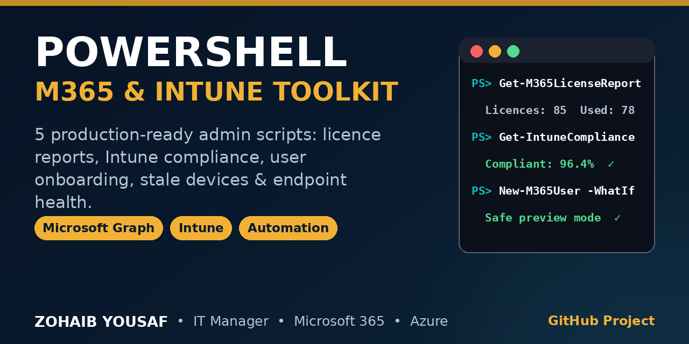

# PowerShell Microsoft 365 & Intune Toolkit




A production-minded collection of PowerShell scripts for **Microsoft 365 and Microsoft Intune administration** — licence reporting, device compliance, user onboarding, stale-device clean-up reviews, and local endpoint health checks.

Built from day-to-day IT operations work: every script has full comment-based help (`Get-Help .\Script.ps1 -Full`), parameter validation, structured output, and CSV/JSON export where it matters. Reporting scripts are **read-only**; the one script that writes files supports `-WhatIf`.

---

## 📂 Project Structure

```
powershell-m365-intune-toolkit/
├── README.md
├── LICENSE
├── .gitignore
├── scripts/
│   ├── Get-M365LicenseReport.ps1
│   ├── Get-IntuneDeviceComplianceReport.ps1
│   ├── New-M365UserOnboarding.ps1
│   ├── Get-StaleADDevices.ps1
│   └── Test-EndpointHealth.ps1
└── output/                  # Generated reports go here (git-ignored)
```

---

## ✅ Requirements

| Requirement | Notes |
|---|---|
| **PowerShell** | Windows PowerShell 5.1 or PowerShell 7+ |
| **Operating system** | Windows (required for `Test-EndpointHealth.ps1`; Graph reporting scripts also run on PowerShell 7 on other platforms) |
| **Microsoft Graph PowerShell SDK** | For the Graph scripts — see modules below |
| **RSAT (optional)** | Only for `Get-StaleADDevices.ps1 -Source ActiveDirectory` |

Install the Graph modules you need:

```powershell
# Core Graph SDK (licence + Intune + Entra ID device scripts)
Install-Module Microsoft.Graph -Scope CurrentUser

# Or install only the sub-modules you use
Install-Module Microsoft.Graph.Authentication -Scope CurrentUser
Install-Module Microsoft.Graph.Identity.DirectoryManagement -Scope CurrentUser
Install-Module Microsoft.Graph.DeviceManagement -Scope CurrentUser
```

**Graph permissions (delegated, least-privilege):**

| Script | Permission |
|---|---|
| `Get-M365LicenseReport.ps1` | `Organization.Read.All`, `LicenseAssignment.Read.All` |
| `Get-IntuneDeviceComplianceReport.ps1` | `DeviceManagementManagedDevices.Read.All` |
| `Get-StaleADDevices.ps1 -Source EntraID` | `Device.Read.All` |

No tenant IDs, UPNs, or credentials are hardcoded anywhere in this toolkit. Authentication is always via `Connect-MgGraph` / your existing Graph session.

---

## 🚀 Usage

### 1. Get-M365LicenseReport.ps1 — Licence usage summary

Shows purchased vs. consumed licences per SKU, with utilisation %, and identifies unused licences for cost reviews.

```powershell
.\scripts\Get-M365LicenseReport.ps1
.\scripts\Get-M365LicenseReport.ps1 -OutputPath ".\output\M365-Licences.csv"
.\scripts\Get-M365LicenseReport.ps1 -IncludeDisabled
```

### 2. Get-IntuneDeviceComplianceReport.ps1 — Device compliance export

Lists Intune managed devices with compliance state, OS, last sync and a stale-sync flag for remediation follow-up.

```powershell
.\scripts\Get-IntuneDeviceComplianceReport.ps1
.\scripts\Get-IntuneDeviceComplianceReport.ps1 -ComplianceState Noncompliant -OutputPath ".\output\noncompliant.csv"
.\scripts\Get-IntuneDeviceComplianceReport.ps1 -OperatingSystem Windows -StaleSyncDays 14
```

### 3. New-M365UserOnboarding.ps1 — Onboarding checklist automation

Generates a structured Markdown onboarding report (+ optional CSV task list) covering account, licence, MFA/Conditional Access, mailbox, Teams, OneDrive and Intune device enrolment. **No tenant is required to generate the report, and no account is created** — it is a reviewed plan for the engineer to execute.

```powershell
.\scripts\New-M365UserOnboarding.ps1 -DisplayName "Ayesha Khan" `
    -UserPrincipalName "ayesha.khan@contoso.com" `
    -Department "Finance" -JobTitle "Accounts Officer" -Manager "Finance Manager"

# Preview only — writes nothing:
.\scripts\New-M365UserOnboarding.ps1 -DisplayName "Test User" `
    -UserPrincipalName "test.user@contoso.com" -ExportCsv -WhatIf
```

> `contoso.com` above is a placeholder example domain — replace it with your own.

### 4. Get-StaleADDevices.ps1 — Stale device finder

Finds computer/device accounts with no logon/sign-in beyond a threshold, from on-premises AD or Entra ID. Review-only: it never disables or deletes accounts.

```powershell
# On-premises Active Directory (default, 90 days)
.\scripts\Get-StaleADDevices.ps1 -DaysInactive 90 -IncludeNeverLoggedOn

# Entra ID devices (60 days)
.\scripts\Get-StaleADDevices.ps1 -Source EntraID -DaysInactive 60 -OutputPath ".\output\stale-entra.csv"
```

### 5. Test-EndpointHealth.ps1 — Local endpoint health check

Read-only checks on the local Windows machine: OS/uptime, disk space, memory, critical services, pending reboot, network adapter, gateway and DNS. Ideal for help-desk triage and onboarding verification.

```powershell
.\scripts\Test-EndpointHealth.ps1
.\scripts\Test-EndpointHealth.ps1 -OutputPath ".\output\health.json"
.\scripts\Test-EndpointHealth.ps1 -DriveWarningPercent 25 -SkipGatewayPing
```

Every script supports detailed built-in help:

```powershell
Get-Help .\scripts\Get-M365LicenseReport.ps1 -Full
```

---

## 🔒 Safety Notes

- **Read-only by design:** Licence, compliance, stale-device and endpoint-health scripts do not modify tenant or device state.
- **`-WhatIf` where state changes:** `New-M365UserOnboarding.ps1` only writes report files, and honours `-WhatIf` / `-Confirm` via `SupportsShouldProcess`.
- **No hardcoded tenant data:** No tenant IDs, domains (other than clearly-marked `contoso.com` examples), UPNs or passwords are stored in any script.
- **Least-privilege permissions:** Each Graph script requests only the read scopes it needs — see the table above.
- **Reports can contain sensitive data:** CSV/JSON exports may include device names, UPNs and licence details. The `output/` folder and export file types are git-ignored by default; handle exports under your organisation's data policy.
- **Review before clean-up:** Stale-device output is a candidate list for human review, not an automatic deletion list.

---

## 👤 Author

**Zohaib Yousaf** — IT Manager / Digital Operations, Islamabad, Pakistan

6+ years in IT support and digital operations (SCCM/Intune, Microsoft 365, Azure, LAN/WAN). Currently preparing for Microsoft MS-900.

- 🌐 Website: [zohaibyousaf.com](https://zohaibyousaf.com)
- 💼 LinkedIn: [linkedin.com/in/zohaibyousaf](https://linkedin.com/in/zohaibyousaf)
- 📧 Email: [info@zohaibyousaf.com](mailto:info@zohaibyousaf.com)

Contributions, issues and suggestions are welcome — please open an issue or a pull request.

## 📄 License

This project is licensed under the [MIT License](LICENSE) — © 2026 Zohaib Yousaf.
